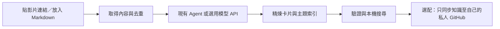

# Auto Knowledge Base

把影片連結或 Markdown 交給 AI，整理成可追溯、可分類、可搜尋的本機知識庫。

**初版以 Windows、現有 AI Agent 為主要使用方式。** 安裝環境並選定知識庫後，日常只需在 Agent 對話中貼入連結。程式負責取得、去重、狀態、驗證與儲存；Agent 負責閱讀全文、精煉與主題判斷。選用 API 模式則由你設定的模型服務完成精煉。

不需要 Gemini Key 才能使用。Gemini 影片備援保持關閉。沒有背景服務、向量資料庫或自訂 Agent 平台。



## 兩種使用方式

| 模式 | 使用方式 | 是否需要另填 API Key |
|---|---|---|
| Agent，預設 | 用可讀寫本機檔案、執行 Python 的 Agent 開啟本專案，貼連結並交辦整理 | 不需要本工具的 Key；Agent 本身的帳號／費用依你使用的產品 |
| API，選用 | 設定相容的模型端點後，執行 `run.bat` 貼連結，或使用 CLI | 雲端通常需要；本機 loopback 服務可無 Key |

單獨執行 Agent 模式的 Python 只會收件並提供待辦，**不會憑空呼叫 Codex 或假裝完成 AI 精煉**。API 模式目前以離線及本機 HTTP 模擬驗證，實際供應商／模型需自行驗收；不是任意模型都相容。

## 首次設定

只整理 Markdown 時，Python 3.12 與現有 Agent 即可開始。搜尋另需 [ripgrep](https://github.com/BurntSushi/ripgrep) 的 `rg` 在 PATH。

```powershell
python -X utf8 -B auto_kb.py init
python -X utf8 -B auto_kb.py doctor
```

預設知識庫為程式目錄下的 `workspace/`，不會加入程式 repository。要指定自己的目錄：

```powershell
python -X utf8 -B auto_kb.py --workspace D:\MyKnowledge init
```

後續命令也使用同一個 `--workspace`；或在你的執行環境設定 `AKB_WORKSPACE`。優先序為命令列、環境變數、預設目錄。不要把程式 repository 根目錄當知識庫。

影片轉錄另需：

1. 安裝 Python 依賴：`python -m pip install -r requirements-transcribe.txt`。
2. 安裝 Node 24 與已安裝的 Edge 或 Chrome，執行 `npm install --ignore-scripts` 安裝宣告的 Playwright；程式不會替你安裝瀏覽器。
3. 安裝 FFmpeg 並加入 PATH，或設定 `AKB_FFMPEG`。
4. 準備符合 [faster-whisper](https://github.com/SYSTRAN/faster-whisper) 格式的本機模型，將 `AKB_MODEL_PATH` 指到包含 `model.bin`、`config.json` 等檔案的目錄。模型可能很大，須依其來源及授權自行下載；執行整理不會暗中下載模型。

可在自己的 `workspace/akb.json` 設定 `engine.model_path`；JSON 中 Windows 路徑使用 `/` 或跳脫的 `\\`。進階環境設定見 [engine/PORTING.md](engine/PORTING.md)。只有本機安裝的依賴及模型，不代表所有平台都能取得內容。

## 日常：在 Agent 貼連結

開啟本專案，讓 Agent 讀取 [AGENTS.md](AGENTS.md)，直接交辦：

> 整理這個影片連結到我的知識庫，並一併處理 markdown 資料夾的新文件：〔貼連結〕

> 找「產品成長實驗」主題至多三支影片，選擇不同觀點，整理成知識卡並附來源。

第二種需要該 Agent 本身有可用的網路搜尋。預設搜尋候選最多三支、每支十分鐘內；**直接貼入的連結沒有十分鐘硬上限**。缺搜尋能力時仍可貼連結，不會偷偷啟用付費搜尋。

Agent 入口命令：

```powershell
python -X utf8 -B auto_kb.py run --mode agent --text "分享文字或一個／多個影片網址"
```

影片與文件的全文閱讀、卡片格式、分類、驗證、歸檔及續跑步驟見 [Agent 工作指引](docs/AGENT_GUIDE.md)。主題由內容逐步形成，沒有預建固定分類；影片標題改變仍以平台＋ID 去重。

## 選用 API 模式

在**自己的知識庫** `akb.json` 設定 `mode: "api"`，並填入 `api.endpoint`、`api.model`。端點必須是完整的 Chat Completions URL，支援 `response_format: json_schema` 的 strict 結構輸出及 `max_completion_tokens`。

- 遠端僅接受 HTTPS，且須由你明確設定 `api.allow_remote: true`；`api.api_key_env` 指定讀取哪一個環境變數，預設 `AKB_API_KEY`。Key 放在自己的執行環境，不寫進 JSON、筆記或 repository。
- 本機端點僅允許 loopback HTTP／HTTPS，可將 `api_key_env` 設為 `null`。本專案不安裝或啟動本機模型伺服器。
- 請先確認模型、資料傳送及費用。程式限制輸入長度、輸出 token、逾時及重試，但不能替代供應商帳務設定或保證免費。
- 傳送範圍為該筆原文、必要來源欄位及既有主題標籤；不附整個知識庫、其他卡片、Cookie 或影音檔。敏感內容掃描是防誤送輔助，不能保證辨識所有秘密；只有你允許傳送的來源才應使用遠端模式。
- 不支援的模型、拒答、截斷、空內容或不符合格式會保留明確失敗，不改用更貴模型或其他服務。超長內容停止並交回 Agent，不靜默截斷。

設定完成後：

```powershell
python -X utf8 -B auto_kb.py run --mode api --text "影片網址"
```

也可雙擊 `run.bat` 開啟簡單終端輸入窗口。這是互動 CLI，沒有常駐網頁服務。API 的機械來源核對不能證明作者主張正確；重要結論仍應回到來源查核。

## 資料與發布

| 知識庫內位置 | 用途 |
|---|---|
| `markdown/` | 手動放入的新 Markdown，每輪掃描頂層 |
| `markdown/processed/` | 精煉驗證後的原件；有版本差異就保留現場 |
| `outputs/`、`videos/` | 原始取得內容及逐字稿，留本機 |
| `knowledge/cards/` | 完成的精煉知識卡，標題＋平台＋ID |
| `knowledge/README.md` | 唯一主題索引 |
| `state/` | 來源收據、API 草稿、失敗及發布狀態，留本機 |

API 寫索引只更新 `akb:index` 標記間的區塊，保留區塊外人工內容；既有索引沒有標記時停止，請先由 Agent 審閱整合。已有卡片內容不同時不覆寫。

預設完全不發布。若需要跨電腦使用，在自己的 `akb.json` 明確設定：

```json
"publish": {
  "enabled": true,
  "repository": "YOUR_ACCOUNT/YOUR_PRIVATE_KNOWLEDGE_REPO",
  "branch": "main"
}
```

先準備已有初始 commit 的私人 GitHub repo、Git 作者身分及已登入的 `gh`。這個目標是**你的私人知識庫，與本開源程式 repo 分開**。發布器在隔離 checkout 只提交驗證過的卡片與索引，檢查整次 outgoing commits，再以一般 fast-forward push 及遠端 bytes 讀回確認；不夾帶本機程式或其他提交。

發布不會更動遠端保護。若目標要求 PR、沒有權限或內容衝突，會停止相關階段；不強推、不繞過政策、不刪遠端資料。第一次連接已有同名索引的 repo 也不直接覆寫，先由 Agent 核對。

## 重試、續跑與限制

- 支援路由：Douyin、YouTube、Instagram、TikTok；Bilibili 為實驗支援，其他來源明確拒絕。是否能取得仍受影片可用性、平台規則與當地環境影響。
- 已驗證的備援及重試放在引擎內；可恢復的錯誤每個 provider 至多兩輪。登入、驗證碼、明確拒絕、DRM、來源不符及本機配置錯誤會停止，不保證「多試一定成功」。
- 已取得的內容、已保存的 API 草稿、已完成的知識與發布收據可續做；重新貼同片不重抓，發布失敗不重新花費模型費用。
- Whisper 主要辨識語音，不能代替完整畫面理解；ASR 可能誤聽。機械驗證、單元測試與 CI 不等於內容真實或所有平台實測通過。
- 初版正式支援 Windows；其他平台的安全原件歸檔／API 索引整合尚未實測，無可靠鎖定方式時保留原件並停止相關寫入。
- 不支援私人清單爬取、自動登入、驗證繞過、付費內容解鎖或背景無人服務。

查進度與搜尋：

```powershell
python -X utf8 -B auto_kb.py status
python -X utf8 -B auto_kb.py search "成長實驗"
```

搜尋先驗證知識卡與索引，再使用 `rg -F` 字面匹配；可嘗試中英文別名，沒有結果就如實回報，不宣稱語意搜尋。其他專案可從任意目錄以本程式絕對路徑及指定 workspace 查詢；私人 GitHub 仍需自己的存取權限。

## 開發與授權

```powershell
python -X utf8 -B run_tests.py core
python -X utf8 -B run_tests.py engine
npm run test:engine
```

測試不需下載影片、模型或呼叫付費 API。runner 使用標準 unittest，先確認專案內測試區可寫，再限制 Python 網路連線；core 只允許 localhost HTTP，engine 不允許連線。Git 發布測試使用本機 bare repo。測試資料保留於 `state/test-runs/`，不以遞迴刪除清理。受限 sandbox 若禁止本機 Git 子程序，需在允許執行本機 Git 的環境驗證，不把權限失敗標成通過。

版本驗收結果見 [docs/VALIDATION.md](docs/VALIDATION.md)。程式採 [MIT License](LICENSE)，第三方方法、套件與模型授權見 [engine/THIRD_PARTY_NOTICES.md](engine/THIRD_PARTY_NOTICES.md)。程式授權不授予影片或其他來源內容的使用權。
