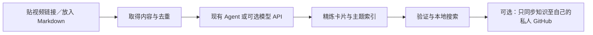

# Auto Knowledge Base

**Give your AI agent video links or Markdown. Build your personal knowledge base with one request.**

After one-time setup and verification, your Agent continues content acquisition, full-text refinement, topic classification, indexing, validation and local storage in the same session. You do not need to run each stage manually. Paste links and Markdown text together, or attach a readable `.md` file; the Agent can save the source Markdown to the inbox and include it in the same task.

Windows is the primary supported platform. Use an Agent that can read and write local files and execute commands. Downloads, costs or permissions may require confirmation; blocked sources are reported. Adding files alone does not start a background task. Agent mode does not require a separate Gemini API key; Gemini video backup remains disabled.

**把视频链接或 Markdown 交给你的 AI Agent，一次交办，整理成自己的知识库。**

首次设置与验证完成后，在 Agent 对话中交办来源，它会在同一工作阶段接续取得内容、全文精炼、主题分类、更新索引、验证与本地储存；正常成功路径不需要你逐阶段操作。视频链接和 Markdown 文字可以一起贴，Agent 能读取的 `.md` 附件也可先存入收件区，一并整理。

初版主要支持 Windows，使用的 Agent 须能读写本地文件及执行命令。需要下载、费用或权限确认时仍会询问；来源受阻时会回报。单纯放入文件不会在背景自动执行。可选 API 模式则由你明确设置的模型服务完成精炼。

不需要 Gemini Key 才能使用。Gemini 视频备用保持关闭。没有背景服务、向量数据库或自订 Agent 平台。



## 两种使用方式

| 模式 | 使用方式 | 是否需要另填 API Key |
|---|---|---|
| Agent，默认 | 用可读写本地文件、执行 Python 的 Agent 开启本项目，贴链接并交办整理 | 不需要本工具的 Key；Agent 本身的账号／费用依你使用的产品 |
| API，可选 | 设置相容的模型端点后，执行 `run.bat` 贴链接，或使用 CLI | 云端通常需要；本地 loopback 服务可无 Key |

单独执行 Agent 模式的 Python 只会收件并提供待办，**不会凭空调用 Codex 或假装完成 AI 精炼**。API 模式目前以离线及本地 HTTP 模拟验证，实际供应商／模型需自行验收；不是任意模型都相容。

## 首次设置

可以直接把 repo 链接交给可读写本地文件、执行命令的 AI Agent：

**English**

> Install and configure https://github.com/AngusDaGG/Auto-Knowledge-Base on this computer. Read README, AGENTS.md and docs/AGENT_SETUP.md, reuse working tools, and complete the required local setup and verification. Ask before additional downloads, costs or permissions. Then help me build my knowledge base by giving you video links or Markdown documents.

**简体中文**

> 请帮我在这台电脑安装并设置 https://github.com/AngusDaGG/Auto-Knowledge-Base 。请先读 README、AGENTS.md 和 docs/AGENT_SETUP.md，沿用可用环境，完成依赖、模型与本地验证；需要额外下载、费用或权限时先询问。完成后让我能贴视频链接整理知识。

Agent 依 [首次安装与验证指引](docs/AGENT_SETUP.md) 接续：检查缺项 → 集中确认必要下载与权限 → 设置本地环境／模型 → 实际验证 → 回报可用功能与未验证项目。用户不必另开安装平台、双击 bat 或逐条执行命令。只有网页聊天、没有本地工具的 Agent 无法代替你安装；不同 Agent 仍遵守自己的权限规则。

只整理 Markdown 时，Python 3.12 与现有 Agent 即可开始，无需安装视频依赖或模型。搜索另需 [ripgrep](https://github.com/BurntSushi/ripgrep) 的 `rg` 在 PATH。

`doctor` 可在尚未初始化时只读检查，不会建立工作区、安装软件包、下载模型或连线。以下命令供 Agent 执行，也可手动使用：

```powershell
python -X utf8 -B auto_kb.py doctor
python -X utf8 -B auto_kb.py init
python -X utf8 -B auto_kb.py doctor
```

`video_missing` 列出缺项；已设置 vendor 的软件包会一并检查。若 `engine.python` 另指其他 Python，软件包显示 `null`，请改用该 Python 执行 doctor。`detected_not_verified` 只代表找到工具、软件包与必要模型文件；仍须依指引做版本、载入及小型功能验证。doctor 成功输出报告不等于视频已可取得。

默认知识库为程序目录下的 `workspace/`，不会加入程序 repository。要指定自己的目录：

```powershell
python -X utf8 -B auto_kb.py --workspace D:\MyKnowledge init
```

后续命令也使用同一个 `--workspace`；或在你的执行环境设置 `AKB_WORKSPACE`。优先序为命令行、环境变量、默认目录。不要把程序 repository 根目录当知识库。

视频转录另需：

1. 在项目 `.venv` 安装 `requirements-transcribe.txt` 既有依赖；已有可用环境则沿用，不强制重装。
2. Node 24、Edge 或 Chrome，以及依 `package-lock.json` 安装的 Playwright。
3. FFmpeg 在 PATH，或透过 `AKB_FFMPEG` 指定。
4. 符合 [faster-whisper](https://github.com/SYSTRAN/faster-whisper) 格式、包含 `model.bin`、`config.json`、`tokenizer.json` 的本地模型。Agent 先核对来源、授权、版本、下载量与硬件需求，取得必要确认后才下载；日常整理不暗中下载模型。

可在自己的 `workspace/akb.json` 设置 `engine.model_path`；JSON 中 Windows 路径使用 `/` 或转义的 `\\`。进阶环境设置见 [engine/PORTING.md](engine/PORTING.md)。只有本地安装的依赖及模型，不代表所有平台都能取得内容。

## 日常：在 Agent 贴链接

开启本项目，让 Agent 读取 [AGENTS.md](AGENTS.md)，直接交办：

**视频链接 / Video links**

> Organize this video into my knowledge base, and include new files in the markdown inbox: [video link]

> 整理这个视频链接到我的知识库，并一并处理 markdown 文件夹的新文件：〔贴链接〕

**同一则消息的视频与 Markdown / Links and Markdown in one message**

> Organize the video links and Markdown text or readable .md attachments in this message together. Save the source Markdown to the inbox, refine the content, classify it, update the index and validate the result: [links and Markdown]

> 把这则消息的视频链接、Markdown 文字或可读取的 .md 附件一并整理；请先保存 Markdown 原件，再接续精炼、分类、更新索引与验证：〔贴链接与 Markdown〕

**主题搜索 / Topic search**

> Find up to three videos about product growth experiments, choose different perspectives, and turn them into knowledge cards with sources.

> 找「产品成长实验」主题至多三支视频，选择不同观点，整理成知识卡并附来源。

主题搜索需要该 Agent 本身有可用的网络搜索。默认搜索候选最多三支、每支十分钟内；**直接贴入的链接没有十分钟硬上限**。缺搜索能力时仍可贴链接，不会偷偷启用付费搜索。

Agent 入口命令：

```powershell
python -X utf8 -B auto_kb.py run --mode agent --text "分享文字或一个／多个视频网址"
```

视频与文件的全文阅读、卡片格式、分类、验证、归档及续跑步骤见 [Agent 工作指引](docs/AGENT_GUIDE.md)。主题由内容逐步形成，没有预建固定分类；视频标题改变仍以平台＋ID 去重。

## 可选 API 模式

在**自己的知识库** `akb.json` 设置 `mode: "api"`，并填入 `api.endpoint`、`api.model`。端点必须是完整的 Chat Completions URL，支持 `response_format: json_schema` 的 strict 结构输出及 `max_completion_tokens`。

- 远端仅接受 HTTPS，且须由你明确设置 `api.allow_remote: true`；`api.api_key_env` 指定读取哪一个环境变量，默认 `AKB_API_KEY`。Key 放在自己的执行环境，不写进 JSON、笔记或 repository。
- 本地端点仅允许 loopback HTTP／HTTPS，可将 `api_key_env` 设为 `null`。本项目不安装或启动本地模型服务器。
- 请先确认模型、数据传送及费用。程序限制输入长度、输出 token、超时及重试，但不能替代供应商帐务设置或保证免费。
- 传送范围为该笔原文、必要来源栏位及既有主题标签；不附整个知识库、其他卡片、Cookie 或音视频文件。敏感内容扫描是防误送辅助，不能保证辨识所有秘密；只有你允许传送的来源才应使用远端模式。
- 不支持的模型、拒答、截断、空内容或不符合格式会保留明确失败，不改用更贵模型或其他服务。超长内容停止并交回 Agent，不静默截断。

设置完成后：

```powershell
python -X utf8 -B auto_kb.py run --mode api --text "视频网址"
```

也可双击 `run.bat` 开启简单终端输入窗口。这是交互 CLI，没有常驻网页服务。API 的机械来源核对不能证明作者主张正确；重要结论仍应回到来源核查。

## 数据与发布

| 知识库内位置 | 用途 |
|---|---|
| `markdown/` | 手动放入的新 Markdown，每轮扫描顶层 |
| `markdown/processed/` | 精炼验证后的原件；有版本差异就保留现场 |
| `outputs/`、`videos/` | 原始取得内容及逐字稿，留本地 |
| `knowledge/cards/` | 完成的精炼知识卡，标题＋平台＋ID |
| `knowledge/README.md` | 唯一主题索引 |
| `state/` | 来源收据、API 草稿、失败及发布状态，留本地 |

API 写索引只更新 `akb:index` 标记间的区块，保留区块外人工内容；既有索引没有标记时停止，请先由 Agent 审阅整合。已有卡片内容不同时不覆写。

默认完全不发布。若需要跨电脑使用，在自己的 `akb.json` 明确设置：

```json
"publish": {
  "enabled": true,
  "repository": "YOUR_ACCOUNT/YOUR_PRIVATE_KNOWLEDGE_REPO",
  "branch": "main"
}
```

先准备已有初始 commit 的私人 GitHub repo、Git 作者身份及已登录的 `gh`。这个目标是**你的私人知识库，与本开源程序 repo 分开**。发布器在隔离 checkout 只提交验证过的卡片与索引，检查整次 outgoing commits，再以一般 fast-forward push 及远端 bytes 读回确认；不夹带本地程序或其他提交。

发布不会更动远端保护。若目标要求 PR、没有权限或内容冲突，会停止相关阶段；不强推、不绕过政策、不删远端数据。第一次连接已有同名索引的 repo 也不直接覆写，先由 Agent 核对。

## 重试、续跑与限制

- 支持路由：Douyin、YouTube、Instagram、TikTok；Bilibili 为实验支持，其他来源明确拒绝。是否能取得仍受视频可用性、平台规则与当地环境影响。
- 已验证的备用及重试放在引擎内；可恢复的错误每个 provider 至多两轮。登录、验证码、明确拒绝、DRM、来源不符及本地配置错误会停止，不保证「多试一定成功」。
- 已取得的内容、已保存的 API 草稿、已完成的知识与发布收据可续做；重新贴同片不重抓，发布失败不重新花费模型费用。
- Whisper 主要辨识语音，不能代替完整画面理解；ASR 可能误听。机械验证、单元测试与 CI 不等于内容真实或所有平台实测通过。
- 初版正式支持 Windows；其他平台的安全原件归档／API 索引整合尚未实测，无可靠锁定方式时保留原件并停止相关写入。
- 不支持私人清单爬取、自动登录、验证绕过、付费内容解锁或背景无人服务。

查进度与搜索：

```powershell
python -X utf8 -B auto_kb.py status
python -X utf8 -B auto_kb.py search "成长实验"
```

搜索先验证知识卡与索引，再使用 `rg -F` 字面匹配；可尝试中英文别名，没有结果就如实回报，不宣称语义搜索。其他项目可从任意目录以本程序绝对路径及指定 workspace 查询；私人 GitHub 仍需自己的存取权限。

## 开发与授权

```powershell
python -X utf8 -B run_tests.py core
python -X utf8 -B run_tests.py engine
npm run test:engine
```

测试不需下载视频、模型或调用付费 API。runner 使用标准 unittest，先确认项目内测试区可写，再限制 Python 网络连线；core 只允许 localhost HTTP，engine 不允许连线。Git 发布测试使用本地 bare repo。测试数据保留于 `state/test-runs/`，不以递归删除清理。受限 sandbox 若禁止本地 Git 子程序，需在允许执行本地 Git 的环境验证，不把权限失败标成通过。

版本验收结果见 [docs/VALIDATION.md](docs/VALIDATION.md)。程序采 [MIT License](LICENSE)，第三方方法、软件包与模型授权见 [engine/THIRD_PARTY_NOTICES.md](engine/THIRD_PARTY_NOTICES.md)。程序授权不授予视频或其他来源内容的使用权。
